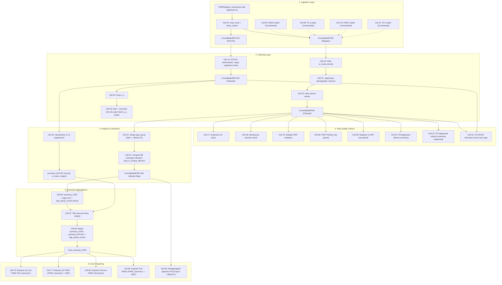

# NOTEBOOK ANALYSIS — OPTIMIZED_DATA_MGT.sanitized.ipynb

Complete audit of all 89 cells (58 code cells, 31 markdown cells) in `reference/OPTIMIZED_DATA_MGT.sanitized.ipynb`.

Audit date: 2026-11-10 | Author: DATAFLOW Engineering Agent | Phase: 0


---

## 1. Executive Summary & Inventory

- **Total Cells:** 89
- **Code Cells:** 58
- **Markdown Cells:** 31
- **Application Flow:** Ingestion -> Minimal Cleaning -> Ad-hoc DQA -> KPLHIV / VL Processing -> Coverage Indicators -> Summary Aggregation -> Excel Generation (4 near-duplicate exporters) -> Disaggregated Pivot Export.


---

## 2. End-to-End Data Flow Architecture (Mermaid)




---

## 3. Detailed Audit of All 89 Cells

The table below documents every single cell (58 code cells and 31 markdown cells). Cell indices are 0-based.

| Cell | Type | Lines | Title | Purpose | Inputs | Outputs | Dependencies | Group |
|---|---|---|---|---|---|---|---|---|
| 00 | MD | 1 | Import Libraries (Markdown) | Notebook section header: Import Libraries | - | - | - | Markdown Header |
| 01 | **CODE** | 9 | Setup & Imports | Imports required libraries (os, pandas, numpy, janitor clean_names/remove_empty, re), sets display options, and prints CWD. Contains hardcoded directory path. | `os`, `sys environment` | `os`, `pd`, `np`, `clean_names`, `remove_empty`, `re`, `directory` | - | Setup |
| 02 | MD | 1 | Load Datasets Header (Markdown) | Notebook section header: Load Datasets | - | - | - | Markdown Header |
| 03 | MD | 1 | FSW Cohort Header (Markdown) | Section sub-header for FSW cohort loading | - | - | - | Markdown Header |
| 04 | **CODE** | 10 | Load FSW Datasets | Reads FSW Register and KPLHIV sheets from .xlsb with skiprows=2, runs pyjanitor clean_names. | `'FSW/FSW Register_Summaries.xlsb'` | `ConsolidatedFSW`, `ConsolidatedKPLHIV` | Cell 01 | Ingestion (Active: FSW) |
| 05 | MD | 1 | MSM Cohort Header (Markdown) | Section sub-header for MSM cohort loading | - | - | - | Markdown Header |
| 06 | **CODE** | 10 | Load MSM Datasets (Commented) | Commented loader for MSM Register ('MSM') and KPLHIV sheets from .xlsb with skiprows=2 and clean_names. | `'MSM/National Consolidated KVP Cohort Register MSM_Q9 JUL-SEP.xlsb'` | `ConsolidatedFSW (commented)`, `ConsolidatedKPLHIV (commented)` | Cell 01 | Ingestion (Alternative Population) |
| 07 | MD | 1 | TG Cohort Header (Markdown) | Section sub-header for TG cohort loading | - | - | - | Markdown Header |
| 08 | **CODE** | 10 | Load TG Datasets (Commented) | Commented loader for TG Register and KPLHIV sheets from .xlsb with skiprows=2 and clean_names. | `'TG/Consolidated TG.xlsb'` | `ConsolidatedFSW (commented)`, `ConsolidatedKPLHIV (commented)` | Cell 01 | Ingestion (Alternative Population) |
| 09 | MD | 1 | PWID Cohort Header (Markdown) | Section sub-header for PWID cohort loading | - | - | - | Markdown Header |
| 10 | **CODE** | 10 | Load PWID Datasets (Commented) | Commented loader for PWID Register and KPLHIV sheets from .xlsx with skiprows=2 and clean_names. | `'PWID/Consolidated PWID Register_September 2026.xlsx'` | `ConsolidatedFSW (commented)`, `ConsolidatedKPLHIV (commented)` | Cell 01 | Ingestion (Alternative Population) |
| 11 | MD | 1 | VP Cohort Header (Markdown) | Section sub-header for VP cohort loading | - | - | - | Markdown Header |
| 12 | **CODE** | 9 | Load VP Datasets (Commented) | Commented loader for VP Register and KPLHIV sheets from .xlsb with skiprows=2 and clean_names. | `'VP/National Consolidated VP Cohort Register-Jul-Sept 2026.xlsb'` | `ConsolidatedFSW (commented)`, `ConsolidatedKPLHIV (commented)` | Cell 01 | Ingestion (Alternative Population) |
| 13 | MD | 1 | Clean KPLHIV Header (Markdown) | Section sub-header for KPLHIV cleaning | - | - | - | Markdown Header |
| 14 | **CODE** | 16 | Clean KPLHIV | Runs element-wise string capitalization and whitespace stripping across all cells of ConsolidatedKPLHIV; renames columns; uppercases keys. | `ConsolidatedKPLHIV` | `ConsolidatedKPLHIV` | Cell 04 | Cleaning |
| 15 | **CODE** | 1 | Inspect FSW Shape | Inspects dimensions of ConsolidatedFSW via .shape. | `ConsolidatedFSW` | `terminal output` | Cell 04 | Exploration |
| 16 | MD | 1 | Check for Duplicates Header (Markdown) | Section sub-header for duplicate check | - | - | - | Markdown Header |
| 17 | **CODE** | 4 | Check Duplicate UICs | Identifies duplicate UICs in ConsolidatedFSW using duplicated(subset=['kp_vp_unique_identifier_code']); prints count and subset. Does not drop duplicates. | `ConsolidatedFSW` | `fsw_dups` | Cell 04 | DQA / Inspection |
| 18 | **CODE** | 10 | Filter Missing SR Name | Filters ConsolidatedFSW to rows where 'sr_name' is not null. Has commented-out .map(capitalize) and .map(strip). | `ConsolidatedFSW` | `ConsolidatedFSW` | Cell 04 | Cleaning |
| 19 | **CODE** | 1 | Inspect FSW Shape (Commented) | Commented check of ConsolidatedFSW.shape after filtering. | `ConsolidatedFSW` | - | Cell 18 | Exploration |
| 20 | MD | 1 | Reshape Demo Columns Header (Markdown) | Header for changing demo columns to upper case | - | - | - | Markdown Header |
| 21 | **CODE** | 7 | Uppercase Demographics | Converts region, sr_name, key_vulnerable_population_type, county, sub_county, ward, kp_vp_unique_identifier_code to uppercase in ConsolidatedFSW. | `ConsolidatedFSW` | `ConsolidatedFSW` | Cell 18 | Cleaning |
| 22 | **CODE** | 7 | Age & Sex Summary | Prints descriptive statistics for 'age' (describe) and value counts for 'sex_m_f_'. | `ConsolidatedFSW` | `age_description`, `gender_distribution` | Cell 21 | Exploration |
| 23 | MD | 1 | Region by SR Distribution Header (Markdown) | Header for crosstab distribution | - | - | - | Markdown Header |
| 24 | **CODE** | 12 | Region by SR Crosstab | Generates crosstab of region by sr_name with dropna=False and styles output table. | `ConsolidatedFSW` | `county_sr`, `styled_table` | Cell 21 | Exploration |
| 25 | MD | 1 | HIV Status At Enrollment Header (Markdown) | Header for HIV status at enrollment inspection | - | - | - | Markdown Header |
| 26 | **CODE** | 17 | HIV Status At Enrollment Frequencies | Computes value_counts(dropna=False) on hiv_status_at_enrollment and formats styled table with Total row. | `ConsolidatedFSW` | `kp_type`, `kp_type_df`, `styled_table` | Cell 21 | Exploration |
| 27 | MD | 1 | Missing Values in Key Columns Header (Markdown) | Header for missing values check | - | - | - | Markdown Header |
| 28 | **CODE** | 3 | Missing Key Column Check | Sums null values in demographic key columns (UIC, county, age, DOB, sex, date_of_enrolment, peer_educator_code). | `ConsolidatedFSW` | `mis` | Cell 21 | DQA / Inspection |
| 29 | **CODE** | 21 | Total Columns & UIC Frequencies | Checks total columns count, value_counts of UIC, and prints duplicate check. | `ConsolidatedFSW` | `total_columns`, `uic_counts`, `styled_table` | Cell 21 | Exploration |
| 30 | **CODE** | 17 | PrEP Status Baseline Frequency | Computes frequency table for baseline 'prep_status' column with total row. | `ConsolidatedFSW` | `prep_counts_df`, `styled_table` | Cell 21 | Exploration |
| 31 | **CODE** | 2 | Column Name Iteration | Iterates over ConsolidatedFSW.columns and prints each column name. | `ConsolidatedFSW` | `terminal output` | Cell 21 | Exploration |
| 32 | **CODE** | 1 | PrEP Status 1 Check | Prints value_counts(dropna=False) for 'prep_status_1'. | `ConsolidatedFSW` | `terminal output` | Cell 21 | Exploration |
| 33 | MD | 1 | Multiple PrEP Initiations Header (Markdown) | Header for dynamic multiple PrEP initiations check | - | - | - | Markdown Header |
| 34 | **CODE** | 45 | Multiple PrEP Initiations DQA | Finds all prep_status_* columns; creates 'prep_initiated' (flag) and 'multiple_prep_initiations' (row-level sum of 'Initiated'); displays frequency table. | `ConsolidatedFSW` | `ConsolidatedFSW['prep_initiated']`, `ConsolidatedFSW['multiple_prep_initiations']` | Cell 21 | DQA Engine |
| 35 | MD | 1 | PrEP and Positive Header (Markdown) | Header for PrEP on Positive clients check | - | - | - | Markdown Header |
| 36 | **CODE** | 20 | PrEP Positive DQA Check | Pairs prep_status_* and hiv_tested_results_* by sorted name; flags rows where prep status is Initiated/Restart/Refill and HIV status is Positive/Known Positive. Creates 'PreP_Positive'. | `ConsolidatedFSW` | `ConsolidatedFSW['PreP_Positive']` | Cell 21 | DQA Engine |
| 37 | MD | 1 | Negative on ART Header (Markdown) | Header for Negative clients on ART check | - | - | - | Markdown Header |
| 38 | **CODE** | 15 | Negative on ART DQA Check | Pairs hiv_tested_results_* and currently_on_art_* by sorted name; flags rows where HIV is Negative and ART is Yes. Creates 'NegativeART'. (Comment erroneously mentions Positive). | `ConsolidatedFSW` | `ConsolidatedFSW['NegativeART']` | Cell 21 | DQA Engine |
| 39 | MD | 1 | TB Diagnosed Without Screening Header (Markdown) | Header for TB screening vs diagnosis check | - | - | - | Markdown Header |
| 40 | **CODE** | 25 | TB Diagnosed Without Screening DQA Check | Checks if all screened_for_tb columns equal 'No' while any diagnosed_with_tb equals 'Yes'. Creates 'TB_CHECK'. | `ConsolidatedFSW` | `ConsolidatedFSW['TB_CHECK']` | Cell 21 | DQA Engine |
| 41 | MD | 1 | STI Diagnosed Without Screening Header (Markdown) | Header for STI screening vs diagnosis check | - | - | - | Markdown Header |
| 42 | **CODE** | 17 | STI Diagnosed Without Screening DQA Check | Uses natsorted on screened_for_stis_* and diagnosed_with_sti_*; checks if all screening columns equal 'No' while any diagnosis column equals 'Yes'. Creates 'STI_CHECK'. | `ConsolidatedFSW` | `ConsolidatedFSW['STI_CHECK']` | Cell 21 | DQA Engine |
| 43 | **CODE** | 4 | Strip Column Names | ConsolidatedFSW.columns = ConsolidatedFSW.columns.str.strip(). | `ConsolidatedFSW` | `ConsolidatedFSW` | Cell 21 | Cleaning |
| 44 | MD | 1 | KPLHIV Section Header (Markdown) | Header for KPLHIV section | - | - | - | Markdown Header |
| 45 | **CODE** | 5 | Clean KPLHIV Serial Number | Drops 's_n' column from ConsolidatedKPLHIV if present. | `ConsolidatedKPLHIV` | `ConsolidatedKPLHIV` | Cell 14 | Cleaning |
| 46 | **CODE** | 2 | KPLHIV Overwrite Defect | BUG: If 's_n' in ConsolidatedFSW.columns, sets ConsolidatedKPLHIV = ConsolidatedFSW.drop(columns=['s_n']), completely wiping KPLHIV data. | `ConsolidatedFSW`, `ConsolidatedKPLHIV` | `ConsolidatedKPLHIV` | Cell 04, Cell 45 | Defect / Bug |
| 47 | MD | 1 | Active Clients in KPLHIV Header (Markdown) | Header for active clients in KPLHIV | - | - | - | Markdown Header |
| 48 | **CODE** | 23 | Active KPLHIV Monthly Aggregation | Loops over hardcoded months ['jul', 'aug', 'sep', 'oct', 'nov', 'dec'], filters where month == 'Active', groups by ['sr_name', 'region'], and counts occurrences. | `ConsolidatedKPLHIV` | `monthly_counts_df` | Cell 14 | Active Clients Analytics |
| 49 | MD | 1 | Active Clients in Register Header (Markdown) | Header for active clients in Cohort Register | - | - | - | Markdown Header |
| 50 | **CODE** | 24 | Active Register Monthly Aggregation | Finds art_outcome_* columns, filters where col == 'Active', groups by ['region', 'sr_name'], counts occurrences. | `ConsolidatedFSW` | `active_counts_df` | Cell 43 | Active Clients Analytics |
| 51 | MD | 1 | CCC Number Mismatch Header (Markdown) | Header for CCC mismatch check | - | - | - | Markdown Header |
| 52 | **CODE** | 68 | CCC / NUPI Mismatch Check | Checks if CCC numbers in ConsolidatedKPLHIV exist in ConsolidatedFSW (one-way). Strips whitespace, drops nulls, strips trailing .0 float artifacts. | `ConsolidatedKPLHIV`, `ConsolidatedFSW` | `mismatches_df`, `report output` | Cell 14, Cell 43 | DQA Engine |
| 53 | MD | 1 | Viral Load Summary Header (Markdown) | Header for viral load standardization and suppression | - | - | - | Markdown Header |
| 54 | **CODE** | 30 | Viral Load Standardization & Suppression | Defines standardize_viral_load and is_suppressed (LDL or <200); creates 'standardized_viral_load' and 'is_suppressed' in ConsolidatedKPLHIV; groups by county, sr_name, region for summary_KPLHIV (Total_KPLHIV nunique, Suppressed sum). | `ConsolidatedKPLHIV` | `ConsolidatedKPLHIV['standardized_viral_load']`, `ConsolidatedKPLHIV['is_suppressed']`, `summary_KPLHIV` | Cell 14 | KPLHIV / Viral Load Analytics |
| 55 | **CODE** | 6 | Inspect Age Column Info | Runs ConsolidatedFSW['age'].info(). | `ConsolidatedFSW` | `terminal output` | Cell 43 | Exploration |
| 56 | MD | 1 | Calculate Age Group Header (Markdown) | Header for age group assignment | - | - | - | Markdown Header |
| 57 | **CODE** | 5 | Assign Age Group (Register) | Assigns 'age_group' using lambda: 15-19, 20-24, 25+, else 'Below 15'. Missing age silently falls into 'Below 15'. | `ConsolidatedFSW` | `ConsolidatedFSW['age_group']` | Cell 43 | Demographics Analytics |
| 58 | **CODE** | 1 | Age Group Value Counts | Displays ConsolidatedFSW['age_group'].value_counts(). | `ConsolidatedFSW` | `terminal output` | Cell 57 | Exploration |
| 59 | **CODE** | 1 | Sex Value Counts | Displays ConsolidatedFSW['sex_m_f_'].value_counts(). | `ConsolidatedFSW` | `terminal output` | Cell 43 | Exploration |
| 60 | MD | 1 | Calculate Coverage Indicators Header (Markdown) | Header for coverage indicators | - | - | - | Markdown Header |
| 61 | **CODE** | 247 | Compute Coverage Indicators | Computes PrEP (q1, q2, sem, refill, initiate, disc), HTS (q1, q2, sem, sem_any, neg, pos), ART (activeart, onart, Positive_art), STI (screened, diag, treat), Peer Education, RRC, TB screening, Condoms (q1, q2, sem, total), NSP (q1, q2, sem, total), PLHIV service (nsp commented out), and Defined Package (nsp commented out). Uses any_in_unique_allrows and positional column slicing [:3], [3:6]. | `ConsolidatedFSW` | `ConsolidatedFSW (88 indicator columns)` | Cell 43, Cell 57 | Indicator Engine |
| 62 | **CODE** | 3 | Print Key Indicator Value Counts | Prints value_counts for definedpackage_q1, hts_q1, prep_q1. | `ConsolidatedFSW` | `terminal output` | Cell 61 | Exploration |
| 63 | **CODE** | 1 | PrEP Status 2 Counts (Commented) | Commented check of prep_status_2 value_counts. | `ConsolidatedFSW` | - | Cell 61 | Exploration |
| 64 | **CODE** | 1 | Print Columns (Commented) | Commented print of ConsolidatedFSW.columns. | `ConsolidatedFSW` | - | Cell 61 | Exploration |
| 65 | MD | 1 | Generate Summary Table Header (Markdown) | Header for summary table generation | - | - | - | Markdown Header |
| 66 | **CODE** | 127 | Generate FSW Summary & Age Group Counts | Pivots age_group_counts by county, sr_name, region; aggregates summary_FSW using TotalCohort (nunique), TotalPE (nunique), and 48 indicator sums across rows. Merges age_group_counts with summary_FSW. | `ConsolidatedFSW` | `age_group_counts`, `summary_FSW`, `final_summary_FSW` | Cell 57, Cell 61 | Summary Engine |
| 67 | **CODE** | 5 | Standardize Join Keys with Title Case | Converts county, sr_name, region to .str.strip().str.title() across summary_FSW, summary_KPLHIV, and age_group_counts. | `summary_FSW`, `summary_KPLHIV`, `age_group_counts` | `summary_FSW`, `summary_KPLHIV`, `age_group_counts` | Cell 54, Cell 66 | Cleaning / Summary Integration |
| 68 | MD | 1 | Final Summary Table Header (Markdown) | Header for final summary table | - | - | - | Markdown Header |
| 69 | **CODE** | 75 | Final Summary Merge & Column Ordering | Merges summary_FSW, summary_KPLHIV, and age_group_counts on ['county', 'sr_name', 'region']. Attempts to order columns referencing OLD_Cohort, NEW_Cohort, TotalCohort. Inserts KPLHIV columns after anchor. | `summary_FSW`, `summary_KPLHIV`, `age_group_counts` | `final_summary_FSW` | Cell 66, Cell 67 | Summary Engine |
| 70 | **CODE** | 4 | Export Register & KPLHIV Excel (Commented) | Commented Excel export of ConsolidatedFSW and ConsolidatedKPLHIV to FSW.xlsx. | `ConsolidatedFSW`, `ConsolidatedKPLHIV` | - | Cell 61 | Reporting (Commented) |
| 71 | **CODE** | 2 | Export CSV (Commented) | Commented CSV export of ConsolidatedFSW and ConsolidatedKPLHIV. | `ConsolidatedFSW`, `ConsolidatedKPLHIV` | - | Cell 61 | Reporting (Commented) |
| 72 | **CODE** | 23 | Define normalize_keys Helper | Defines normalize_keys helper function converting keys to title case and string. | - | `normalize_keys` | - | Helpers |
| 73 | **CODE** | 3 | Uppercase Geography Keys in Raw Frames | Loops over [ConsolidatedFSW, ConsolidatedKPLHIV] and uppercases county, sr_name, region (conflicts with cell 67/72 title case). | `ConsolidatedFSW`, `ConsolidatedKPLHIV` | `ConsolidatedFSW`, `ConsolidatedKPLHIV` | Cell 04, Cell 14 | Cleaning |
| 74 | MD | 1 | Q1 Export Header (Markdown) | Header for Q1 export | - | - | - | Markdown Header |
| 75 | **CODE** | 350 | Exporter: Q1 Non-PWID | Builds and formats Q1-only Excel workbook for FSW/MSM/TG/VP without NSP into sheet 'KP_Summary' using openpyxl (Cascadia Code headers, Candara data, merged headers, TOTAL row formula). | `ConsolidatedFSW`, `summary_KPLHIV` | `KP_Summary Excel workbook` | Cell 54, Cell 61 | Excel Exporter (1/4) |
| 76 | MD | 1 | Q1 PWID Export Header (Markdown) | Header for Q1 PWID export | - | - | - | Markdown Header |
| 77 | **CODE** | 350 | Exporter: Q1 PWID | Builds and formats Q1-only Excel workbook for PWID with NSP block into sheet 'PWID_Summary' using openpyxl. | `ConsolidatedFSW`, `summary_KPLHIV` | `PWID_Summary Excel workbook` | Cell 54, Cell 61 | Excel Exporter (2/4) |
| 78 | **CODE** | 3 | Run PWID Export (Commented) | Commented call to build_final_summary and export_like_template for PWID. | `ConsolidatedFSW`, `summary_KPLHIV` | - | Cell 77 | Reporting (Commented) |
| 79 | MD | 1 | Pivoted Summary Non-PWID Header (Markdown) | Header for Full summary non-PWID | - | - | - | Markdown Header |
| 80 | **CODE** | 370 | Exporter: Full Semester Non-PWID | Builds and formats Q1/Q2/SEM Excel workbook for FSW/MSM/TG/VP without NSP into sheet 'Summary' using openpyxl. | `ConsolidatedFSW`, `summary_KPLHIV` | `Summary Excel workbook` | Cell 54, Cell 61 | Excel Exporter (3/4) |
| 81 | MD | 1 | Pivoted PWID Summary Header (Markdown) | Header for Full summary PWID | - | - | - | Markdown Header |
| 82 | **CODE** | 409 | Exporter: Full Semester PWID | Builds and formats Q1/Q2/SEM Excel workbook for PWID with NSP block into sheet 'PWID_Summary' using openpyxl. | `ConsolidatedFSW`, `summary_KPLHIV` | `PWID_Summary Excel workbook` | Cell 54, Cell 61 | Excel Exporter (4/4) |
| 83 | **CODE** | 19 | Shared Excel Styling Constants | Defines GROUP_HEADER_COLORS dict for styling headers. | - | `GROUP_HEADER_COLORS` | - | Styling |
| 84 | **CODE** | 343 | Exporter: Disaggregated Age/Sex Pivot | Assigns age_group ('Unknown' for NaN) and sex_group (.fillna('F') for NaN); creates age_sex_group; exports multi-level pivoted summary for coverage indicators (PrEP_SEM, HTS_Tested, DefinedPackage_SEM) with openpyxl styling. | `ConsolidatedFSW` | `Disaggregated Age/Sex Excel workbook` | Cell 61 | Excel Exporter (Disaggregated Pivot) |
| 85 | **CODE** | 1 | Sex Group Value Counts | Displays kvp_merged['sex_group'].value_counts(). | `kvp_merged` | `terminal output` | Cell 84 | Exploration |
| 86 | **CODE** | 9 | Print Row-Level Defined Package Totals | Prints row-level DefinedPackage_SEM sum vs pivoted table sums. | `kvp_merged` | `terminal output` | Cell 84 | Exploration |
| 87 | **CODE** | 1 | Print HTS_Tested Total | Displays kvp_merged['HTS_Tested'].sum(). | `kvp_merged` | `terminal output` | Cell 84 | Exploration |
| 88 | **CODE** | 0 | Empty Code Cell | Empty code cell with 0 lines of code. | - | - | - | Empty |

*Total audited code cells: 58 (matches required 58).*


---

## 4. Side-by-Side Diff and Structural Comparison of Cells 75, 77, 80, 82

The notebook contains four exporter functions across cells 75, 77, 80, and 82. They share ~90% of their logic and styling code, differing only in population features (NSP) and reporting period scope (Q1 vs Full Semester).

### Exporter Comparison Matrix

| Dimension | Cell 75 | Cell 77 | Cell 80 | Cell 82 |
|---|---|---|---|---|
| **Population Scope** | Non-PWID (FSW, MSM, TG, VP) | PWID | Non-PWID (FSW, MSM, TG, VP) | PWID |
| **Period Scope** | Q1 Only | Q1 Only | Full Semester (Q1, Q2, SEM) | Full Semester (Q1, Q2, SEM) |
| **Target Sheet Name** | `KP_Summary` | `PWID_Summary` | `Summary` | `PWID_Summary` |
| **Total Lines** | 350 lines | 350 lines | 370 lines | 409 lines |
| **NSP Block Included?** | No | Yes (`NSP_Q1`, `total_nsp_Q1`) | No | Yes (`NSP_Q1..SEM`, `total_nsp_Q1..SEM`) |
| **Header Rows** | 2 (Row 1 Group, Row 2 Subheader) | 2 (Row 1 Group, Row 2 Subheader) | 2 (Row 1 Group, Row 2 Subheader) | 2 (Row 1 Group, Row 2 Subheader) |
| **Header Font** | Cascadia Code, Bold, 11pt | Cascadia Code, Bold, 11pt | Cascadia Code, Bold, 11pt | Cascadia Code, Bold, 11pt |
| **Data Font** | Candara, Regular, 11pt | Candara, Regular, 11pt | Candara, Regular, 11pt | Candara, Regular, 11pt |
| **Subheader Fill** | Coral (`FF7D81`) | Coral (`FF7D81`) | Coral (`FF7D81`) | Coral (`FF7D81`) |
| **TOTAL Fill** | Green (`6BD669`) | Green (`6BD669`) | Green (`6BD669`) | Green (`6BD669`) |
| **TOTAL Row Formula** | `=SUM(X3:Xn)` merged cols 1-3 | `=SUM(X3:Xn)` merged cols 1-3 | `=SUM(X3:Xn)` merged cols 1-3 | `=SUM(X3:Xn)` merged cols 1-3 |
| **Column Widths** | Keys: 22, Data: 14 | Keys: 22, Data: 14 | Keys: 22, Data: 14 | Keys: 22, Data: 14 |
| **Freeze Panes** | `A3` | `A3` | `A3` | `A3` |
| **Gridlines** | Hidden (`showGridLines=False`) | Hidden (`showGridLines=False`) | Hidden (`showGridLines=False`) | Hidden (`showGridLines=False`) |

### Detailed Structural Diff

1. **Cell 75 vs Cell 77 (Q1 Non-PWID vs Q1 PWID):**
   - Cell 77 adds `"NSP": "FF7D81"` to `GROUP_HEADER_COLORS`.
   - Cell 77 adds `NSP_Q1` and `total_nsp_Q1` to `.agg(...)` in `build_summary_fsw`.
   - Cell 77 adds the block `("NSP", ["Q1", "TOTQ1"], ["NSP_Q1", "total_nsp_Q1"])` to `blocks`.
   - Sheet name changes from `KP_Summary` to `PWID_Summary`.
2. **Cell 80 vs Cell 82 (Full Non-PWID vs Full PWID):**
   - Cell 82 adds `"NSP": "FF7D81"` to `GROUP_HEADER_COLORS`.
   - Cell 82 adds `NSP_Q1`, `NSP_Q2`, `NSP_SEM`, `total_nsp_Q1`, `total_nsp_Q2` to `.agg(...)`.
   - Cell 82 adds the block `("NSP", ["Q1", "Q2", "SEM", "TOTQ1", "TOTQ2", "SEM"], ["NSP_Q1", "NSP_Q2", "NSP_SEM", "total_nsp_Q1", "total_nsp_Q2", "total_nsp_SEM"])`.
   - Bug in Cell 82: `total_nsp_SEM` is listed in `blocks` and `template_order` but is **never computed**, causing silent omission via column filtering.
3. **Cell 75 vs Cell 80 (Q1 Non-PWID vs Full Non-PWID):**
   - Cell 75 includes only Q1 aggregations in `.agg(...)`; Cell 80 includes Q1, Q2, and SEM aggregations.
   - Block definitions in Cell 75 only have Q1 subheaders; Cell 80 expands each block to [Q1, Q2, SEM] (and TOTQ1, TOTQ2, SEM for commodities).
   - Sheet name is `KP_Summary` in Cell 75 vs `Summary` in Cell 80.

---

## 5. Unified Parametrised Exporter Proposal

Instead of maintaining 4 copy-pasted exporter functions totaling 1,479 lines of redundant code, DATAFLOW will implement a single parametrised openpyxl exporter in `reporting/excel_exporter.py`.

### Architecture of the Single Exporter

```python
def export_summary_workbook(
    summary_df: pd.DataFrame,
    population: str,             # 'FSW' | 'MSM' | 'PWID' | 'TG' | 'VP'
    period_mode: str,            # 'Q1' | 'Q2' | 'SEM'
    template_spec: ExcelTemplateSpec,
    output_path: Path,
    include_metadata: bool = True
) -> Path:
    """
    Unified exporter replacing Cells 75, 77, 80, 82.
    - Config-driven column blocks and subheaders loaded from config/reporting/excel_templates.yaml.
    - Sheet name resolved from population and period ('PWID_Summary', 'KP_Summary', or 'Summary').
    - NSP block dynamically included if population == 'PWID'.
    - Cascadia Code bold headers, Candara data rows, coral subheaders (FF7D81), green totals (6BD669).
    - TOTAL row with Excel SUM formulas merged across columns 1-3.
    - Automated sheet creation: 'Summary', 'Run Metadata', 'Cleaning Log'.
    """
```

### Key Benefits:

1. **Single Source of Truth:** Styling rules, fonts, fills, and borders are defined once in configuration.

2. **Zero Code Duplication:** Eliminates 1,400+ lines of duplicate openpyxl code.

3. **Safe Column Filtering:** Prevents silent drops (such as the `total_nsp_SEM` bug in Cell 82).

4. **Auditability:** Automatically adds `Run Metadata` and `Cleaning Log` sheets to the export package.
